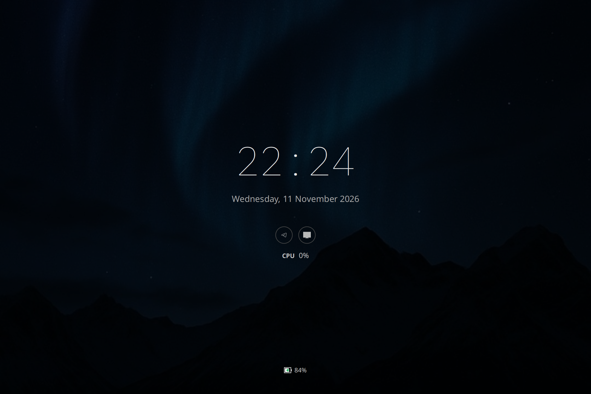
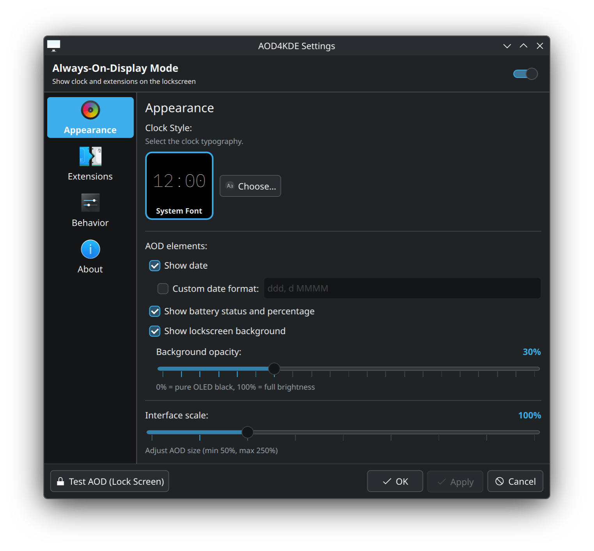
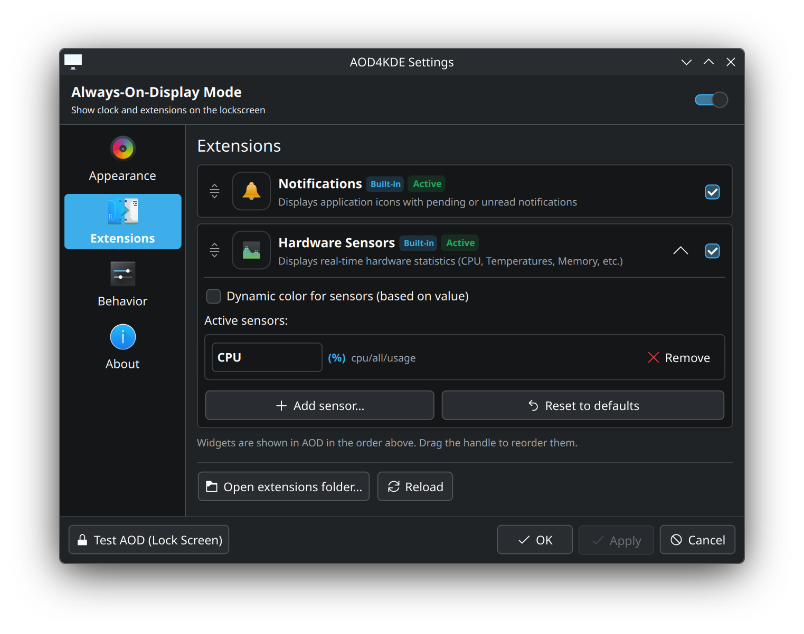

# 

[](https://kde.org)
[](https://wayland.freedesktop.org)
[](https://www.qt.io)
[](https://isocpp.org)
[](https://github.com/francescomosca/aod4kde/releases)
[](./LICENSE)


A customizable, lightweight Always-On-Display (AOD) screen for KDE Plasma 6 that integrates directly into the native lockscreen.

- [](#)
  - [Features](#features)
  - [Screenshots](#screenshots)
  - [Installation](#installation)
  - [Architecture](#architecture)
  - [FAQ](#faq)
  - [Known Issues & Troubleshooting](#known-issues--troubleshooting)
  - [License](#license)
  - [Support the project](#support-the-project)

> [!NOTE]
> Some of the code and documents were created with the assistance of AI tools. The content is reviewed and refined by [the author](https://github.com/francescomosca/) to ensure it meets the project standards.

## Features

-  **KDE Integration:** Injected directly into the KDE Plasma lockscreen (`kscreenlocker_greet`) via native QML overlays for seamless performance without heavy wrappers.
- 🎨 **Customization:** Configure clock styles, battery percentage display, wallpaper overlay dimming, and quick status toggles.
- 🧩 **Modular Extensions:** Dedicated plugin architecture to extend lockscreen capabilities.
  - _Built-in:_ **Notifications** display
  - _Built-in:_ **System Sensors** monitoring (CPU, GPU, RAM, Temps)
  - [Build your own extension >](./docs/custom_extensions/README.md)
- 🛡️ **Burn-in Protection:** Designed for OLED screens, featuring timed pixel-shifting of all AOD elements to protect your display from image retention.
- 🖥️ **Multi-Display & DPI Aware:** Automatic screen detection, multi-monitor configuration, preferred display selection, and fractional scaling support.
- 🌍 **Localization:** Multi-language support (`KF6::I18n`) _(currently: English, Italian)_.


## Screenshots

| Always-On Display |
| :---: |
|  |

| Settings - Appearance | Settings - Extensions |
| :---: | :---: |
|  |  |

## Installation

### Quick Install

Run the automated installer in your terminal:
```bash
bash -c "$(curl -fsSL https://raw.githubusercontent.com/francescomosca/aod4kde/main/tools/web-install.sh)"
```
_Automatically detects your distribution and installs the latest version using native packages or pre-built binaries._

---

### Manual Installation

#### Arch Linux
Download the `.pkg.tar.zst` file from the [Releases](https://github.com/francescomosca/aod4kde/releases) page (or via `curl`) and install it locally with `pacman`:
```bash
curl -fLO https://github.com/francescomosca/aod4kde/releases/latest/download/aod4kde-bin-x86_64.pkg.tar.zst
sudo pacman -U aod4kde-bin-x86_64.pkg.tar.zst
```

<details>
<summary>

##### Building locally with makepkg

</summary>

If you prefer building or packaging locally without downloading pre-built packages from GitHub:
```bash
git clone https://github.com/francescomosca/aod4kde.git
cd aod4kde/packaging/arch/aod4kde-bin  # or 'aod4kde' to build from source
makepkg -si
```
</details>

> [!NOTE]
> _AUR packages will be published once new account registrations on the AUR reopen._

#### Other Distributions (Pre-compiled Tarball)
Download and install the latest release tarball directly:
```bash
curl -sSL https://github.com/francescomosca/aod4kde/releases/latest/download/aod4kde-linux-x86_64.tar.gz | tar -xz && ./aod4kde/install.sh
```

Or download `aod4kde-*.tar.gz` manually from the [Releases](https://github.com/francescomosca/aod4kde/releases) page:
```bash
tar -xzf aod4kde-*.tar.gz
cd aod4kde
./install.sh
```

---

### From source

<details>
<summary>

#### Prerequisites
</summary>
<ul>
<li>KDE Plasma >= 6.0</li>
<li>Qt 6 (Base, Declarative, SVG)</li>
<li>KDE Frameworks 6 (KF6::I18n, KF6::Kirigami, plasma5support, libksysguard)</li>
<li>Build essentials (g++, make, pkg-config, gettext)</li>
</ul>
</details>

#### Build and Install
```bash
git clone https://github.com/francescomosca/aod4kde.git
cd aod4kde
./install-deps.sh # install all required dependencies automatically
./install.sh
```

> [!NOTE]
> `./install.sh` builds the C++ binaries, configures automatic system update hooks, performs a headless dry-run test of the lockscreen patch, and activates the user tray service.

### Uninstallation

#### Arch Linux (`pacman`)
If installed via the native package (`.pkg.tar.zst` or `makepkg`):
```bash
sudo pacman -R aod4kde-bin
# or 'sudo pacman -R aod4kde' if built from source
```
_Pacman's pre-remove hook automatically restores the original KDE lockscreen file and removes all hooks._

#### Manual / Tarball installs
If installed using `./install.sh`:
```bash
./uninstall.sh
```

## Architecture

[AOD4KDE architecture >](./docs/ARCHITECTURE.md)


## FAQ

1. **Why does AOD4KDE patch the system lockscreen instead of running as a standalone overlay window?**

KScreenLocker strictly isolates the lockscreen (especially on Wayland via `ext-session-lock-v1`): no external process or normal window is allowed to render on top of `kscreenlocker_greet` while the session is locked. Injecting the QML overlay directly into the lockscreen greeter is the only way to achieve a native Always-On Display without compromising session security.

2. **What happens if a KDE Plasma update changes the lockscreen code?**

When `plasma-desktop` is updated, the automated update hook (Pacman, APT, or systemd watcher) re-triggers the patcher. If KDE's upstream QML structure has fundamentally changed, the headless validation dry-run detects the mismatch, aborts safely, and restores the original stock lockscreen so you are never locked out.

3. **How does AOD4KDE handle multi-monitor setups and fractional scaling?**

AOD4KDE detects all active outputs dynamically. Through `aod-settings`, you can choose to mirror the AOD across all monitors or restrict it to a specific display. All element coordinates, fonts, and paddings scale dynamically using `uiScale`, ensuring pixel-perfect display across mixed DPI setups (e.g. 100% and 150%).

## Known Issues & Troubleshooting

### Greeter (`kscreenlocker_greet`) Crash Risk & Emergency Recovery
Because AOD is injected directly into `LockScreenUi.qml`, it does **not** run in a sandboxed process. It executes within `kscreenlocker_greet`, sharing its main UI thread, Qt Quick QML engine, and memory space.

**Failure Handling & Resilience:**
- **JavaScript Errors & Broken Extensions**: Extensions are instantiated dynamically via QML `Loader` components. Non-fatal JS exceptions or faulty extensions simply fail into a `Loader.Error` state without crashing the lockscreen.
- **Hard Crashes & OOM Events**: If a severe bug or kernel OOM event terminates `kscreenlocker_greet`:
  - **No Security Bypass**: The session **never** unlocks itself automatically when the greeter process dies.
  - **Watchdog Restart**: KWin immediately detects the failure and attempts to restart the greeter (`Greeter process exit unregular. Restarting lock.`).
  - **KDE Emergency Mode**: If the greeter enters a continuous crash loop, KDE switches to its built-in emergency locker (`Everything else failed. Need to put Greeter in emergency mode.`), bypassing QML entirely to present a barebones QWidget password prompt so you can always log back in.

**Manual TTY Emergency Recovery:**
If the interface ever completely freezes (e.g. an infinite loop blocking the graphical thread):
1. Switch to a virtual console (`Ctrl + Alt + F3` or `F2`) and log in.
2. Force-unlock the session or restore the stock lockscreen:
   ```bash
   # Unlock the active session immediately:
   loginctl unlock-session $XDG_SESSION_ID

   # Or completely restore the clean KDE stock lockscreen from backup:
   sudo mv -f /usr/share/plasma/shells/org.kde.plasma.desktop/contents/lockscreen/LockScreenUi.qml.stock_backup \
              /usr/share/plasma/shells/org.kde.plasma.desktop/contents/lockscreen/LockScreenUi.qml

   # Or re-test and repair the patch:
   sudo /usr/local/lib/aod4kde/patch-lockscreen.sh
   ```

---

## License

AOD4KDE is licensed under the **GNU General Public License v2.0 or later** (`GPL-2.0-or-later`). See [LICENSE](./LICENSE) for the full license text.

Bundled clock fonts in [`assets/fonts/`](./assets/fonts/) are licensed under the **SIL Open Font License 1.1** (`OFL-1.1`). See [`assets/fonts/OFL.txt`](./assets/fonts/OFL.txt) for individual font copyright notices and terms.

## Support the project

If you appreciate AOD4KDE and want to support its continued development, consider:
- Buying me a coffee: <br>[](https://ko-fi.com/K8P82AC2RZ) <small>_(Thank you!)_</small>
- Contributing by opening an issue or a pull request.
